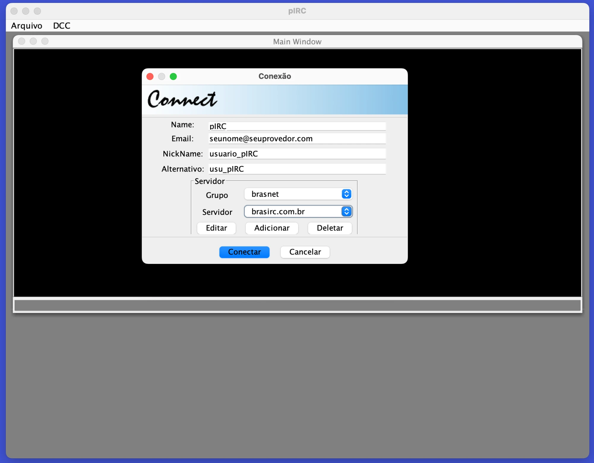

# pIRC — Portable IRC

**pIRC (portable IRC) is an IRC client written in 100% Pure Java.**

Created in 2002 by **Ademir Constantino Filho**, with the collaboration of
**João Pedrosa**. Original project page: https://portableirc.sourceforge.io/



## History

pIRC was born in 2002 as one of my first projects in Java, written for
Java 1.3 with Swing. It was developed on SourceForge, where its code was kept
in a CVS repository.

This repository is the recovery of that code:

- **Source:** CVS repository of the project at SourceForge
- **Branch:** 1.2
- **Last change on SourceForge:** 13/11/2004

After the recovery, the client was completed (connection, servers list,
private messages and protocol fixes) and **ported to Java 17**: Maven build,
generics, records, switch expressions, `java.time`, explicit charsets and unit
tests, with no deprecated APIs.

### Credits

- **Ademir Constantino Filho** — author of pIRC
- **João Pedrosa** — collaboration, including the mIRC color/style stripping
  (`ColorStrip`)

## Scope

pIRC is a small desktop IRC client. Each channel, private conversation and
the server messages have their own window inside the main pIRC window.
The interface is in Portuguese.

What it does:

- Connects to an IRC server chosen from a list grouped by network
  (`cfg/servers.xml`); servers can be added, edited and deleted in the
  *Conexão* window
- Nickname and alternative nickname, used when the first one is in use
- Channels: join, part, topic, list of nicknames ordered by status
  (operators `@`, voice `+`, users), joins, parts, quits, kicks, modes and
  nickname changes
- Private messages: double-click a nickname to open a private window,
  incoming private messages open one automatically
- Commands typed with `/` are sent to the server (`/join`, `/part`, `/nick`,
  `/quit`, `/mode`, ...), plus `/msg <nick> <text>` and `/me <text>`
- CTCP: answers `VERSION` and `PING`, shows `ACTION` (`/me`)
- Removes the mIRC colors and styles from the messages
- Messages in UTF-8 and ISO-8859-1 (Latin-1) are shown correctly; messages are
  sent in UTF-8
- Basic ident server (port 113, needs special privileges on most systems)
- Splash screen when started with `java -jar`

Not implemented yet:

- DCC (send and chat) and the *Opções* (options) dialog — the menu items exist
  but are disabled
- The profiles, translations and themes in `cfg/profiles.xml`, `cfg/i18n` and
  `cfg/themes` came from the original project and are not used by the code yet
- SSL/TLS connections, SASL and IRCv3 features

## Requirements

- JDK 17 or newer
- Maven 3 (optional, to run the tests)

## Build and run

With Maven (compiles, runs the tests and creates `target/pirc.jar`):

	mvn package
	java -jar target/pirc.jar

Without Maven (creates `pirc.jar`, does not run the tests):

	./build.sh
	java -jar pirc.jar

Run it from the project directory: pIRC reads the servers from
`cfg/servers.xml`. The splash screen is shown only when pIRC is started with
`java -jar`.

## Usage

1. Open *Arquivo > Conectar*
2. Fill in the name, e-mail, nickname and alternative nickname
3. Choose the group (network) and the server, and click *Conectar*
4. Type `/join #channel` in the *Main Window*

Text typed in a channel or private window is sent as a message to it. Text
starting with `/` is sent as an IRC command:

| Command | Description |
| --- | --- |
| `/join #channel` | Joins a channel |
| `/part #channel` | Leaves the channel (closing its window does the same) |
| `/nick newnick` | Changes your nickname |
| `/msg nick text` | Sends a private message |
| `/me text` | Sends an action (`* nick text`) |
| `/quit` | Disconnects from the server |

Any other command is sent to the server as typed (`/mode`, `/topic`,
`/whois`, ...).

## Servers list

The servers are kept in `cfg/servers.xml`, one `server` element per server:

```xml
<?xml version="1.0" encoding="UTF-8"?>
<servers>
<server url="irc.brasirc.com.br" port="6667" group="brasnet" name="brasirc.com.br"/>
</servers>
```

- `url` — server address
- `port` — server port (usually 6667)
- `group` — network, used to group the servers in the *Conexão* window
- `name` — name shown in the list

The file is rewritten when servers are added, edited or deleted in the
*Conexão* window.

## Project structure

```
src/main/java/org/aconstantino/pirc   sources
src/main/resources/org/aconstantino/pirc   images and sounds
src/test/java/org/aconstantino/pirc   unit tests (JUnit 5)
cfg/                                  servers list and original configuration files
license/                              license
build.sh                              build without Maven
pom.xml                               Maven build
```

Main classes:

- `PIRCFrame` — main window and `main` method; connection and typed commands
- `ProtocolHandler` — reads the server lines and updates the windows
- `IrcMessage` — parses an IRC line (prefix, command, parameters)
- `IRCSocket` — connection to the server, encoding of the lines
- `PIRCConnectionWindow` / `PIRCEditServer` — connection and servers dialogs
- `PIRCMainWindow`, `PIRCChannelWindow`, `PrivateMessageSession` — chat windows

## License

pIRC is free software, distributed under the terms of the GNU General Public
License, version 2 or (at your option) any later version.

The license text extracted from the original project (unofficial Brazilian
Portuguese translation of the GPL) is in
[`license/GPL-pt_BR.txt`](license/GPL-pt_BR.txt). The official English text is
at https://www.gnu.org/licenses/old-licenses/gpl-2.0.html.

Copyright (C) 2002 Ademir Constantino Filho
